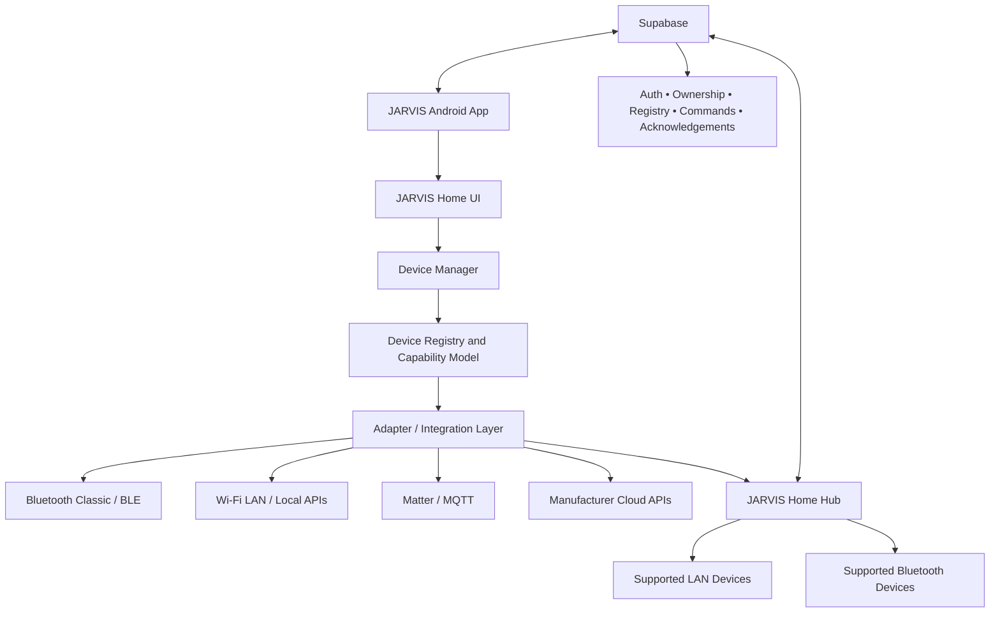
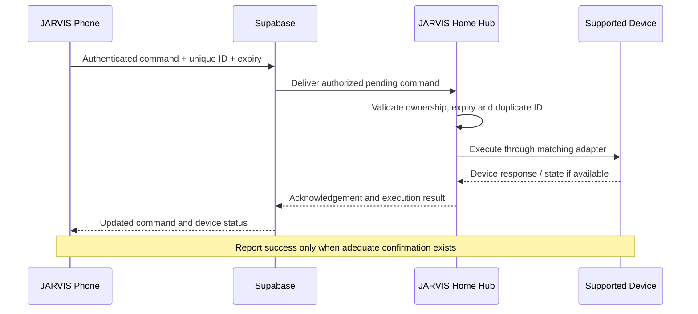
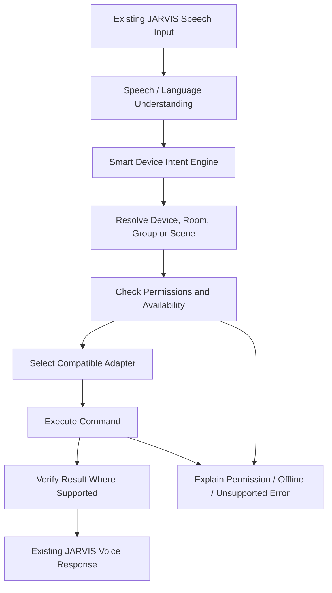
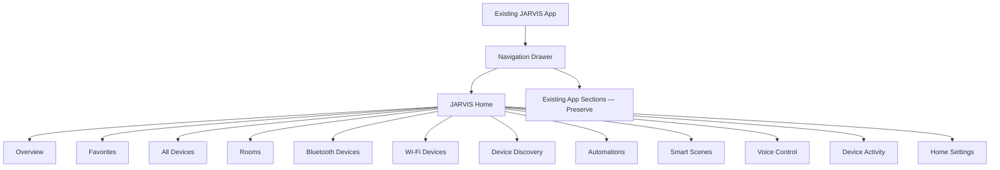

# JARVIS Home --- Complete Smart Home Ecosystem

## Development specification and Claude implementation prompt

**Repository:** https://github.com/sukantcodes/The-Ultimate-Jarvis.apk\
**Exclusive target branch:** `Antigravity`\
**Protected branches:** `Main` and every other existing branch\
**Platform:** Existing JARVIS Android application\
**Backend:** Existing Supabase infrastructure\
**Feature:** JARVIS Home --- smart-home and universal device-control
system

> This document is the implementation brief for Claude in Antigravity.
> It includes the finalized product requirements, skeletal architecture
> diagrams, UI wireframes, and the full implementation prompt. The
> diagrams are conceptual architecture/wireframes, not proof that
> integrations already exist.

------------------------------------------------------------------------

# Part A --- Product requirements

## 1. Product vision

Build **JARVIS Home** as a complete smart-device control centre inside
the existing JARVIS Android app. It must support manual touch control
and integration with the existing JARVIS voice assistant.

Final decisions:

  -----------------------------------------------------------------------
  Area                                Decision
  ----------------------------------- -----------------------------------
  Bluetooth                           Bluetooth Classic and BLE where
                                      supported

  Wi-Fi                               LAN and supported Wi-Fi device
                                      protocols

  Device priority                     Bluetooth and Wi-Fi equally

  Local access                        Yes

  Remote access                       Yes

  Remote architecture                 Manufacturer cloud APIs **and**
                                      JARVIS Home Hub

  Manufacturer compatibility          Broad, extensible ecosystem;
                                      prioritize supported standards and
                                      official APIs

  Automation                          Advanced scenes, schedules,
                                      conditions and multi-device
                                      routines

  Controls                            Voice and manual touch

  Dashboard                           Full advanced dashboard

  UI                                  Reuse the app's existing Liquid
                                      Glass Bubble effect

  Backend                             Reuse existing Supabase project and
                                      authentication
  -----------------------------------------------------------------------

**Compatibility boundary:** There is no universal protocol that makes
every Bluetooth or Wi-Fi device controllable. A device must expose a
supported profile, service, local API, cloud API, bridge, or other
integration. The app must show unsupported capabilities honestly.

## 2. Navigation and dashboard

Add a primary **JARVIS Home** entry to the existing navigation drawer.
Preserve all existing drawer entries and functionality.

JARVIS Home pages:

1.  Overview
2.  Favorites
3.  All Devices
4.  Rooms
5.  Bluetooth Devices
6.  Wi-Fi Devices
7.  Device Discovery
8.  Automations
9.  Smart Scenes
10. Voice Control
11. Device Activity
12. Home Settings

### Dashboard content

-   Registered device count
-   Online and offline counts
-   Bluetooth and Wi-Fi connection summaries
-   Favorite and recently used devices
-   Room shortcuts
-   Search and filters
-   Device cards with name, manufacturer, category, connection type,
    room, status and supported controls
-   Individual and group controls
-   Connection and command status
-   Quick actions for Voice, Scenes and Add Device

Never use hardcoded demo statistics or fake online/offline states in
production.

## 3. UI design direction

Use the existing JARVIS **Liquid Glass Bubble** implementation. Inspect
and reuse the actual components, animation, effects, theme configuration
and rendering logic already in the repository. Do not introduce a second
unrelated glass system.

Visual direction:

-   Premium dark futuristic interface
-   Layered translucent glass surfaces
-   Subtle cyan/blue highlights
-   Rounded device cards and status indicators
-   Smooth transitions and restrained animations
-   Strong text contrast and readable typography
-   Consistent spacing and responsive layouts
-   Accessibility and appropriate touch targets
-   Respect existing theme behavior

The supplied smart-home reference image should guide information
hierarchy and general layout, not be copied pixel-for-pixel. Add the
original reference image to the repository's documentation assets if it
is available in the working environment and its use is permitted.

### Dashboard skeletal wireframe

``` text
┌──────────────────────────────────────────┐
│ JARVIS HOME                 Search  Alerts│
│ Your connected world                     │
├──────────────────────────────────────────┤
│ ┌────────────┐ ┌────────────┐ ┌─────────┐ │
│ │  DEVICES   │ │   ONLINE   │ │ OFFLINE │ │
│ │    --      │ │     --     │ │   --    │ │
│ └────────────┘ └────────────┘ └─────────┘ │
├──────────────────────────────────────────┤
│ MY DEVICES                         View all│
│ ┌──────────────────┐ ┌─────────────────┐ │
│ │ Living room light│ │ Smart TV        │ │
│ │ Room • Wi-Fi     │ │ Room • LAN      │ │
│ │ Status / Control │ │ Status / Control│ │
│ └──────────────────┘ └─────────────────┘ │
│ ┌──────────────────┐ ┌─────────────────┐ │
│ │ Bluetooth speaker│ │ Smart plug      │ │
│ │ Room • Bluetooth │ │ Room • Wi-Fi    │ │
│ │ Status / Control │ │ Status / Control│ │
│ └──────────────────┘ └─────────────────┘ │
├──────────────────────────────────────────┤
│ QUICK ACTIONS                             │
│ [ Voice ]       [ Scenes ]     [ + Add ]  │
└──────────────────────────────────────────┘
```

The `--` values above are placeholders for live values, not values to
hardcode.

## 4. Device discovery and management

Create a guided Add Device workflow:

1.  User opens Device Discovery.
2.  User chooses Bluetooth, BLE, Wi-Fi/LAN, Matter, MQTT or a supported
    integration.
3.  App requests the required Android permissions with clear
    explanations.
4.  App discovers compatible devices using the relevant protocol.
5.  Results show available identity, manufacturer and connection details
    when known.
6.  User selects a device and completes pairing or authorization.
7.  User assigns a name and room.
8.  Device is saved to the device registry.
9.  Dashboard shows its actual status and supported capabilities.

Include search, filters, duplicate detection, retry, diagnostics,
rename, room assignment and removal.

### Device capability model

A device must advertise only capabilities actually supported by its
adapter. Examples include power, brightness, color, temperature
setpoint, volume, playback, sensor reading or a manufacturer-specific
action. Do not show controls that cannot be executed.

## 5. Connectivity and adapter architecture

Support an extensible adapter architecture for:

-   Bluetooth Classic, supported profiles and compatible device
    protocols
-   Bluetooth Low Energy and compatible GATT services/characteristics
-   Local network discovery and supported LAN APIs
-   Matter-compatible devices
-   MQTT-compatible devices
-   Official manufacturer cloud APIs
-   Supported local HTTP/WebSocket protocols
-   Manufacturer bridges and hubs

Each adapter should define discovery, identity, authentication,
connection lifecycle, capabilities, command execution, status reporting
and error handling.

Do not invent endpoints, reverse-engineer protected services, bypass
pairing, or claim broad manufacturer compatibility without a real tested
integration.

### Connectivity architecture diagram



## 6. Local and remote control

### Local control

When the phone is in range and has permission, use direct Bluetooth or
supported LAN control. Prefer local control when available and
authorized.

### Remote control

Support both:

1.  Official manufacturer cloud APIs for devices that provide them.
2.  A separately running JARVIS Home Hub for supported devices reachable
    on the home network.

Supabase can provide authentication, device registry, synchronization,
command routing and acknowledgements. Supabase by itself cannot reach a
private home LAN device without a reachable gateway or manufacturer
cloud integration.

A Bluetooth device outside the phone's or gateway's Bluetooth range
cannot be controlled directly. The Home Hub must be
physically/network-local to the Bluetooth device and have compatible
hardware.

### Remote command flow



### Supabase data model --- proposed, inspect existing schema first

Possible entities/tables (adapt to existing naming and schema; do not
blindly duplicate existing tables):

-   `homes`
-   `home_members`
-   `home_hubs`
-   `devices`
-   `device_capabilities`
-   `rooms`
-   `device_commands`
-   `device_events`
-   `automations`
-   `automation_runs`

Use ownership-aware Row Level Security. Never put Supabase service-role
credentials in the Android app. Store sensitive tokens securely and
avoid logging credentials.

Command records should include a unique ID, target device, action
payload, authenticated owner, creation time, expiry, status and
acknowledgement. Prevent expired or duplicate commands from executing.

## 7. JARVIS Home Hub

Initial target: Windows 11. Build it as a separate, modular gateway
deliverable, not as part of the Android APK.

Hub responsibilities:

-   Authenticate securely with the existing backend
-   Register and report presence
-   Discover supported devices on the local network
-   Communicate with compatible LAN devices
-   Support compatible Bluetooth adapters
-   Receive authenticated, non-expired remote commands
-   Validate ownership and prevent duplicate execution
-   Return real device state when available
-   Report failures and reconnect after network interruptions

Prefer secure outbound connections. Do not require exposing unsafe
public ports or disabling firewall protections. Design for future
additional host platforms.

## 8. Voice assistant integration

Integrate with the **existing JARVIS voice assistant** and existing
speech recognition, wake-word, language and response systems. Do not
create a parallel assistant or break current wake-word behavior.

Build a Smart Device Intent Engine that resolves:

-   Device name and user-defined aliases
-   Device category
-   Room name
-   Requested action
-   Group action
-   Scene name

Example commands:

-   "Jarvis, turn on my bedroom lights."
-   "Jarvis, switch off the living room fan."
-   "Jarvis, connect to my Bluetooth speaker."
-   "Jarvis, show all offline devices."
-   "Jarvis, activate movie mode."
-   "Jarvis, switch everything off in my room."
-   "Jarvis, what devices are connected?"

Support Hindi, English and Hinglish through the existing language
infrastructure.

Voice command pipeline:



Voice control must work outside the JARVIS Home page through the
existing assistant experience. If execution fails, communicate the
actual reason. Never announce success without adequate confirmation.

## 9. Rooms, groups and favorites

Implement:

-   Create, rename and delete rooms
-   Assign and move devices
-   Custom room names and icons
-   Room-level device lists and quick actions
-   Room favorites
-   Device favorites
-   Multi-device groups
-   Group controls limited to compatible actions

## 10. Advanced automation and scenes

Implement a real automation engine with:

-   Time-based schedules
-   Repeating schedules
-   Multi-device routines
-   Sequential actions
-   Conditional triggers
-   Device-state triggers where supported
-   Delayed actions
-   Enable, pause, resume, edit and delete
-   Execution history and failure reporting

Provide editable scene templates:

-   Good Morning
-   Good Night
-   Movie Mode
-   Away Mode
-   Work Mode
-   All Off

Do not assume a device supports an action. Require configuration of
target devices and actions before a scene can run. Respect Android
background execution restrictions and use suitable scheduling/work
mechanisms.

## 11. Device activity and diagnostics

Show:

-   Connection and disconnection events
-   Successful and failed commands
-   Automation executions
-   Last-seen time
-   Connection type
-   Relevant diagnostic information

Avoid recording credentials or unnecessarily sensitive command contents.

## 12. JARVIS Home settings

Organize settings into:

1.  Device Discovery
2.  Bluetooth Management
3.  Wi-Fi Management
4.  Manufacturer Integrations
5.  Home Hub Configuration
6.  Voice Control
7.  Automation Preferences
8.  Room Management
9.  Notifications
10. Security and Permissions
11. Diagnostics
12. Backup and Restore

## 13. Security, reliability and performance

-   Secure authentication and authorization
-   Supabase RLS and device ownership validation
-   Encrypted network communication
-   Secure local credential storage
-   Runtime permission handling
-   Command expiry and duplicate prevention
-   Connection timeouts and reconnection
-   Honest online/offline states
-   Confirmation for consequential actions
-   No secrets in logs
-   No main-thread blocking
-   No unnecessary continuous scanning
-   Lifecycle-safe Bluetooth and network handling
-   Avoid memory leaks
-   Responsive UI with many devices
-   Preserve existing SDK and app compatibility

------------------------------------------------------------------------

# Part B --- Skeletal diagrams and screen concepts

## 14. Navigation structure



## 15. Device discovery wireframe

``` text
┌──────────────────────────────────────────┐
│ ← Add Device                              │
│ Find devices compatible with JARVIS       │
├──────────────────────────────────────────┤
│ [ Bluetooth ] [ Wi-Fi / LAN ] [ Matter ] │
│                                          │
│          Searching for devices            │
│             (scan indicator)              │
│                                          │
├──────────────────────────────────────────┤
│ DISCOVERED DEVICES                        │
│ ┌──────────────────────────────────────┐ │
│ │ Device name       BLE       [Add]    │ │
│ │ Manufacturer / available details     │ │
│ └──────────────────────────────────────┘ │
│ ┌──────────────────────────────────────┐ │
│ │ Device name       LAN       [Add]    │ │
│ │ Manufacturer / available details     │ │
│ └──────────────────────────────────────┘ │
│                                          │
│ [ Scan again ]                            │
└──────────────────────────────────────────┘
```

## 16. Automation wireframe

``` text
┌──────────────────────────────────────────┐
│ ← Automations                       [+]  │
│ Routines for your connected devices      │
├──────────────────────────────────────────┤
│ ┌──────────────────────────────────────┐ │
│ │ Good Night                    [ON]   │ │
│ │ Time trigger • Selected room devices│ │
│ │ Last run: actual recorded result    │ │
│ └──────────────────────────────────────┘ │
│ ┌──────────────────────────────────────┐ │
│ │ Movie Mode                    [ON]   │ │
│ │ Manual trigger • Configured actions │ │
│ └──────────────────────────────────────┘ │
│                                          │
│ [+ Create automation]                    │
│                                          │
│ Recent execution history                 │
└──────────────────────────────────────────┘
```

## 17. Device control wireframe

``` text
┌──────────────────────────────────────────┐
│ ← Living Room Light                       │
│ Manufacturer • Actual connection type    │
├──────────────────────────────────────────┤
│              DEVICE ICON                 │
│          Actual reported status          │
│                                          │
│ [ Power ]       [ Favorite ]             │
│                                          │
│ Supported controls only:                 │
│ Brightness ────────────────               │
│ Color / temperature (if supported)       │
│                                          │
│ Connection diagnostics                    │
│ Last seen • Adapter • Status             │
└──────────────────────────────────────────┘
```

## 18. Image references

No generated images are included in this document. The following image
slots are intended for real reference assets supplied in the repository
or approved by the project owner.

Recommended documentation asset structure:

``` text
docs/
└── jarvis-home/
    ├── Home.md
    └── assets/
        ├── smart-home-reference.png
        ├── dashboard-overview.png
        ├── device-discovery.png
        ├── device-control.png
        └── automation-dashboard.png
```

Use Markdown image syntax after the corresponding reference images have
actually been added:

``` markdown


```

Do not create fake screenshots or use these paths as if the images
already exist. If a supplied reference image is available in the
repository/workspace, copy it into the assets folder with permission and
link it from this document. Otherwise leave the image slots clearly
marked until real assets are supplied.

------------------------------------------------------------------------

# Part C --- Claude implementation prompt

The following is the complete task to execute. Treat all requirements
above as the accepted product specification.

## 19. Your mission

You are responsible for implementing a complete, production-oriented
smart-home and device-control ecosystem inside my existing JARVIS
Android application.

I do not want a conceptual design, static UI, prototype, or collection
of nonfunctional buttons.

I want actual implementation with working functionality, proper
architecture, real device communication, voice integration, remote
connectivity, and a premium user experience.

Inspect the repository first, understand its existing architecture, and
then implement the feature.

Do not ask me to design the feature again. The product requirements are
finalized in this document.

## 20. Strict Git rules

1.  Work exclusively on `Antigravity`.
2.  Never commit, merge, push, or modify `Main`.
3.  Never modify other existing branches.
4.  Verify the current branch before making changes.
5.  If `Antigravity` does not exist, stop and report instead of silently
    using another branch.
6.  Commit changes only to `Antigravity`.
7.  Preserve existing project files and functionality.
8.  Never perform destructive Git operations.
9.  Inspect existing uncommitted changes and preserve the user's work.
10. Do not replace the existing application with a new project.

## 21. Repository inspection

Before coding:

-   Inspect project modules, build files and SDK versions.
-   Inspect navigation drawer implementation.
-   Locate and understand the existing Liquid Glass Bubble system.
-   Inspect existing voice recognition, wake-word and language handling.
-   Inspect existing AI intent/action architecture.
-   Inspect Supabase initialization, authentication, schema assumptions
    and existing policies.
-   Inspect existing device permissions and Android lifecycle handling.
-   Identify existing tests and CI workflows.
-   Identify reusable components and avoid duplicate systems.

Write a short implementation checklist in the repository documentation
or your work notes, then proceed with implementation.

## 22. Implementation phases

**Phase 1 --- Navigation and UI**

Add JARVIS Home to the navigation drawer and implement all dashboard
pages using the existing Liquid Glass Bubble system. Preserve other
navigation and app features.

**Phase 2 --- Device registry**

Implement device identity, ownership, capabilities, room assignment,
favorites, status and persistence.

**Phase 3 --- Bluetooth**

Implement Android Bluetooth Classic/BLE discovery and communication for
genuinely compatible profiles/services. Handle permissions, pairing,
connection lifecycle and errors.

**Phase 4 --- Wi-Fi and LAN**

Implement supported local discovery and protocol adapters, including
applicable Matter, MQTT and manufacturer integrations. Do not imply
arbitrary Wi-Fi devices are controllable.

**Phase 5 --- Voice**

Connect the Smart Device Intent Engine to existing JARVIS speech,
wake-word and response systems. Support Hindi, English and Hinglish
using existing language infrastructure.

**Phase 6 --- Automation**

Implement configurable scenes, schedules, conditions, multi-device
routines, execution history and error handling.

**Phase 7 --- Supabase and remote access**

Reuse the existing Supabase project and authentication. Implement secure
registry synchronization, RLS, command delivery, acknowledgement, expiry
and deduplication. Integrate official manufacturer cloud APIs where
credentials and documentation are available.

**Phase 8 --- Windows Home Hub**

Implement a separate Windows 11 gateway with secure authentication,
presence, LAN discovery, compatible Bluetooth support, command execution
and acknowledgements. Keep it separate from the Android APK build.

**Phase 9 --- Security and diagnostics**

Implement permissions, ownership checks, secure storage, encrypted
communication, diagnostics, timeout/retry behavior and safe failure
handling.

**Phase 10 --- Build and regression testing**

Run tests and Android build. Verify existing app functionality has not
regressed.

## 23. Detailed functional requirements

### Navigation

-   Add JARVIS Home as a primary drawer item.
-   Implement all twelve pages defined in Part A.
-   Preserve existing sections and state behavior.

### UI

-   Reuse existing Liquid Glass Bubble implementation.
-   Use responsive, accessible layouts.
-   Provide loading, empty, permission-denied, offline, unsupported and
    error states.
-   Never display fake live statistics.

### Device integrations

-   Use modular adapters.
-   Advertise only real capabilities.
-   Implement discovery, authorization, control, status and diagnostics.
-   Provide manufacturer-specific integration only when supported by
    real documentation and credentials.

### Voice

-   Reuse existing JARVIS voice assistant.
-   Resolve device, room, group and scene intents.
-   Check permissions and connectivity before execution.
-   Verify results when possible.
-   Report unsupported or failed commands accurately.

### Automation

-   Implement real schedules, triggers, conditions, scenes and
    multi-device routines.
-   Make all templates configurable.
-   Record execution results.
-   Respect Android background execution constraints.

### Supabase

-   Inspect existing schema before adding tables.
-   Reuse existing authentication.
-   Add only necessary migrations.
-   Enforce RLS and ownership.
-   Never embed service-role keys in the app.
-   Use unique command IDs, expiry and acknowledgements.
-   Avoid exposing device credentials.

### Home Hub

-   Build separately for Windows 11.
-   Use secure outbound communication.
-   Validate ownership and command expiry.
-   Discover and control only supported devices.
-   Report actual device state and failures.

## 24. Testing requirements

Run:

1.  Existing unit tests.
2.  New adapter and device-registry tests.
3.  Automation engine tests.
4.  Command expiry and duplicate tests.
5.  Supabase authorization/RLS tests where environment permits.
6.  Android compilation.
7.  Existing authentication regression checks.
8.  Existing voice and wake-word regression checks.
9.  Navigation regression checks.
10. Liquid Glass rendering checks.
11. Offline/error-state checks.

Do not claim physical Bluetooth, Wi-Fi or manufacturer compatibility has
been verified without actual hardware and integration testing.

Inspect the existing GitHub Actions workflow. If appropriate, run the
Antigravity branch workflow without changing protected branches.

Do not modify unrelated workflows unnecessarily.

## 25. Final delivery report

Provide a factual report containing:

-   Files created and modified
-   Navigation changes
-   UI implementation
-   Device registry implementation
-   Bluetooth and BLE adapters
-   Wi-Fi and LAN adapters
-   Matter/MQTT support actually implemented
-   Manufacturer integrations actually implemented
-   Voice integration
-   Automation implementation
-   Supabase migrations and policies
-   Home Hub implementation status
-   Security and diagnostics
-   Tests executed and their results
-   Android build result
-   APK artifact location if successfully generated
-   Home Hub build/package location if generated
-   Commit IDs on Antigravity
-   Completed features
-   Partially implemented features
-   Features requiring hardware, credentials, manufacturer approval or
    external setup

Separate verified results from untested capabilities.

## 26. Final instruction

Start by inspecting the actual repository and the `Antigravity` branch.

Then implement JARVIS Home directly inside the existing application.

Do not stop after creating the UI.

Do not create fake device integrations.

Do not replace existing functionality.

Do not touch `Main` or any other branch.

Do not claim completion without build and test evidence.

Complete as much as the repository, dependencies, credentials and test
environment genuinely permit.

The final objective is a working, expandable JARVIS Smart Home ecosystem
integrated into my existing Android application, with a separately
deliverable Windows Home Hub and secure remote-control architecture.
